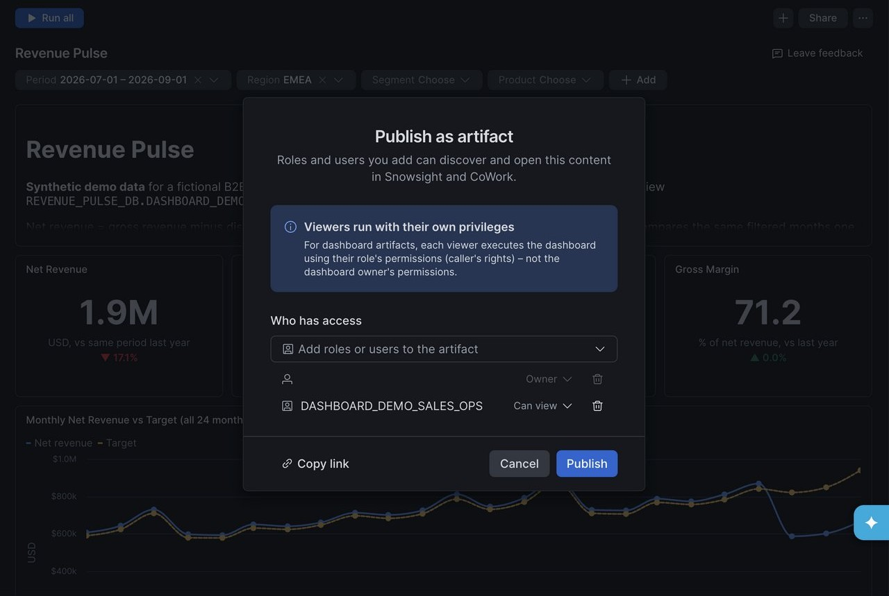
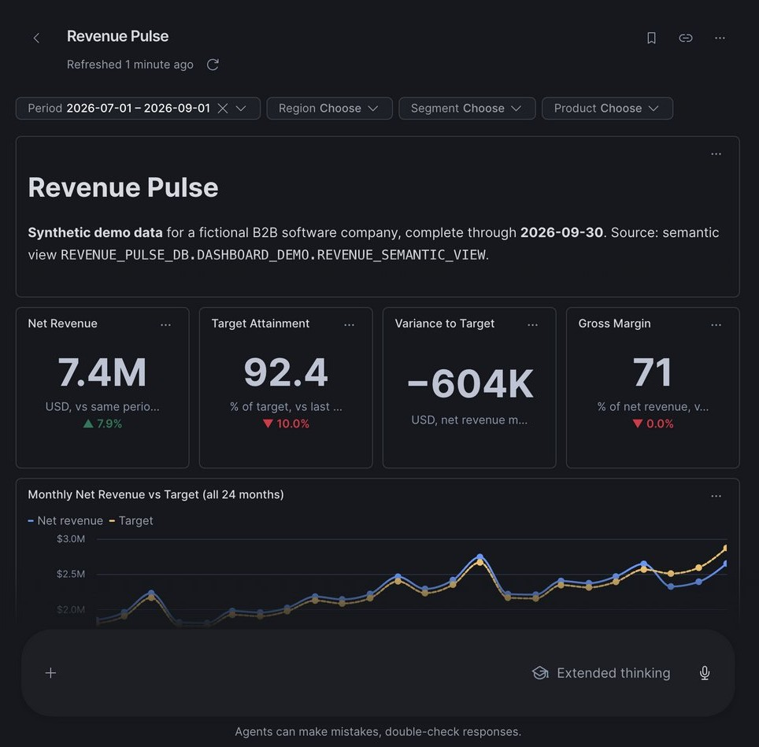
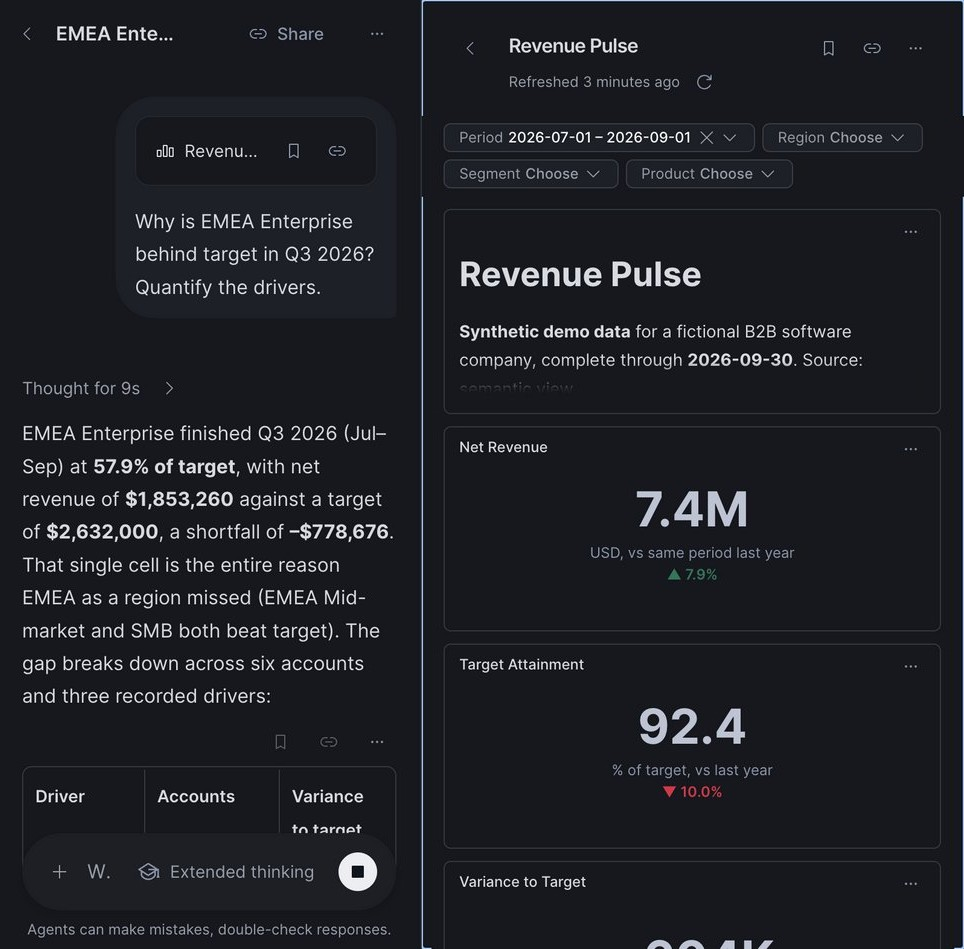

author: Chanin Nantasenamat
id: build-a-revenue-dashboard-with-snowflake-workspaces
categories: snowflake-site:taxonomy/solution-center/certification/quickstart, snowflake-site:taxonomy/product/analytics, snowflake-site:taxonomy/product/ai
language: en
summary: Build a native Workspaces dashboard on a semantic view, publish it to a role, and ask why the numbers moved in Snowflake CoWork.
environments: web
status: Published
feedback link: https://github.com/Snowflake-Labs/sfquickstarts/issues
fork repo link: https://github.com/sfc-gh-cnantasenamat/build-a-revenue-dashboard-with-snowflake-workspaces

# Build a Revenue Dashboard with Snowflake Workspaces and CoWork

## Overview

An analyst already has a revenue semantic view and a Cortex Agent that the sales team uses. What's missing is a shared view the team checks every morning. In this guide you build that view as a native Workspaces dashboard (a `.dash` file) on the semantic view, publish it to a sales-ops role, and then open it in Snowflake CoWork and ask follow-up "why" questions about the numbers.

All data is synthetic: a fictional B2B software company with 54 accounts, 3 product lines, and 24 months of revenue through September 30, 2026. The data contains a story. Q3 2026 net revenue is up 7.9% year over year but $603.6K behind target, and almost all of that gap is EMEA Enterprise.

### What You'll Learn
- How to model revenue, targets, and margin as a semantic view with additive metrics
- How to create a Cortex Agent with a Cortex Analyst tool over that semantic view
- How a `.dash` file defines tiles, filters, layout, and SQL datasources
- How to publish a dashboard as an artifact to a single role, with caller's rights
- How to ask follow-up questions about a dashboard in CoWork, and keep recorded drivers separate from hypotheses

### What You'll Build
A "Revenue Pulse" dashboard with four KPI scorecards, a 24-month trend, a variance-by-region bar chart, a region-by-segment attainment heatmap, a recorded-driver chart, and an account table. Period, Region, Segment, and Product filters drive every tile.

### Prerequisites
- Access to a [Snowflake account](https://signup.snowflake.com/?utm_source=snowflake-devrel&utm_medium=developer-guides&utm_cta=developer-guides)
- A role that can create databases, semantic views, agents, and roles (this guide uses `ACCOUNTADMIN`)
- Access to Workspaces dashboards and Snowflake CoWork in your account
- A role with the `MANAGE ARTIFACT PUBLICATION` privilege, which is needed to publish dashboards to Snowflake CoWork
- Python 3.10+ with `snowflake-connector-python`, and a named connection in your Snowflake connections config
- The `cortex` CLI, used to deploy the agent and upload the dashboard file
- A copy of the companion repository

## Setup

### Configure the Project

Clone the companion repository. Edit `config/demo.json` to point at your own account, database, warehouse, and connection. The deploy script refuses to run if the organization and account it connects to don't match `expected_organization` and `expected_account`, which keeps you from loading into the wrong account.

```json
{
  "seed": 42,
  "start_month": "2024-10-01",
  "months": 24,
  "reporting_cutoff": "2026-09-30",
  "connection": "<your_connection>",
  "expected_organization": "<YOUR_ORG>",
  "expected_account": "<YOUR_ACCOUNT>",
  "database": "REVENUE_PULSE_DB",
  "schema": "DASHBOARD_DEMO",
  "warehouse": "COMPUTE_WH",
  "viewer_role": "DASHBOARD_DEMO_SALES_OPS",
  "semantic_view": "REVENUE_SEMANTIC_VIEW",
  "agent": "REVENUE_ADVISOR"
}
```

The SQL files and the agent spec use fully qualified names. Replace `REVENUE_PULSE_DB` and `COMPUTE_WH` in the code below with your own values if they differ. The setup script creates `REVENUE_PULSE_DB` for you. Every object in this guide lives in that one database, so you can remove them all with one statement at the end.

### Generate the Data

The generator is deterministic (seed 42) and stores money as integer cents, so totals reconcile exactly. Run it, then run its unit tests:

```bash
python3 scripts/generate_data.py
python3 -m unittest discover -s tests -v
```

This writes `data/customers.csv`, `data/products.csv`, and `data/revenue_monthly.csv`. Every revenue row carries a `RECORDED_DRIVER` value: `NORMAL_TRADING`, `RECORDED_RENEWAL_DELAY`, `RECORDED_CONTRACT_DOWNSIZE`, or `RECORDED_DISCOUNT_AND_SERVICE_CREDIT`. These stand in for reasons a sales-ops team logged against each account.

## Load the Data

### Create Tables and Stage

`sql/01_setup.sql` creates a dedicated database for the guide. It is non-destructive and uses `IF NOT EXISTS` everywhere:

```sql
-- Revenue Pulse demo objects. Non-destructive: IF NOT EXISTS everywhere.
-- A dedicated database holds everything, so sql/99_cleanup.sql can drop it in one statement.
CREATE DATABASE IF NOT EXISTS REVENUE_PULSE_DB
  COMMENT = 'Revenue Pulse developer guide (synthetic data). Safe to drop after the guide.';

CREATE SCHEMA IF NOT EXISTS REVENUE_PULSE_DB.DASHBOARD_DEMO
  COMMENT = 'Revenue Pulse Dashboards 2.0 demo (synthetic data)';

CREATE TABLE IF NOT EXISTS REVENUE_PULSE_DB.DASHBOARD_DEMO.CUSTOMERS (
  CUSTOMER_ID VARCHAR NOT NULL PRIMARY KEY,
  CUSTOMER_NAME VARCHAR NOT NULL,
  REGION VARCHAR NOT NULL,
  SEGMENT VARCHAR NOT NULL
) COMMENT = 'Synthetic customer accounts';

CREATE TABLE IF NOT EXISTS REVENUE_PULSE_DB.DASHBOARD_DEMO.PRODUCTS (
  PRODUCT_ID VARCHAR NOT NULL PRIMARY KEY,
  PRODUCT_NAME VARCHAR NOT NULL
) COMMENT = 'Synthetic product lines';

CREATE TABLE IF NOT EXISTS REVENUE_PULSE_DB.DASHBOARD_DEMO.REVENUE_MONTHLY (
  REVENUE_ID VARCHAR NOT NULL PRIMARY KEY,
  MONTH DATE NOT NULL,
  CUSTOMER_ID VARCHAR NOT NULL,
  PRODUCT_ID VARCHAR NOT NULL,
  GROSS_REVENUE_CENTS NUMBER(18,0) NOT NULL,
  DISCOUNT_CENTS NUMBER(18,0) NOT NULL,
  REFUND_CENTS NUMBER(18,0) NOT NULL,
  COST_CENTS NUMBER(18,0) NOT NULL,
  TARGET_CENTS NUMBER(18,0) NOT NULL,
  RECORDED_DRIVER VARCHAR NOT NULL
) COMMENT = 'Synthetic revenue at account x product x month grain';

CREATE STAGE IF NOT EXISTS REVENUE_PULSE_DB.DASHBOARD_DEMO.LOAD_STAGE
  FILE_FORMAT = (TYPE = CSV SKIP_HEADER = 1 FIELD_OPTIONALLY_ENCLOSED_BY = '"');
```

### Run the Deploy Script

`scripts/deploy.py` checks the account, runs the setup SQL, and loads each CSV. Each load runs PUT, then maps columns by header position, then TRUNCATE and COPY. Last, it creates the semantic view.

```bash
python3 scripts/deploy.py
```

You should see 54 rows in `CUSTOMERS`, 3 in `PRODUCTS`, and 3,888 in `REVENUE_MONTHLY`.

## Create the Semantic View

`sql/02_semantic_view.sql` (run by the deploy script) defines facts in USD, dimensions such as region, segment, and recorded driver, and metrics for net revenue, target, variance, attainment, and margin. Ratio metrics use `DIV0NULL` so an empty slice returns null instead of an error.

```sql
CREATE OR REPLACE SEMANTIC VIEW REVENUE_PULSE_DB.DASHBOARD_DEMO.REVENUE_SEMANTIC_VIEW
  TABLES (
    revenue AS REVENUE_PULSE_DB.DASHBOARD_DEMO.REVENUE_MONTHLY PRIMARY KEY (REVENUE_ID)
      COMMENT = 'Monthly revenue, target, and cost per customer and product. Synthetic.',
    customers AS REVENUE_PULSE_DB.DASHBOARD_DEMO.CUSTOMERS PRIMARY KEY (CUSTOMER_ID)
      WITH SYNONYMS = ('accounts', 'clients') COMMENT = 'Customer accounts with sales region and segment',
    products AS REVENUE_PULSE_DB.DASHBOARD_DEMO.PRODUCTS PRIMARY KEY (PRODUCT_ID)
      WITH SYNONYMS = ('product lines') COMMENT = 'Product lines'
  )
  RELATIONSHIPS (
    revenue_to_customers AS revenue (CUSTOMER_ID) REFERENCES customers,
    revenue_to_products AS revenue (PRODUCT_ID) REFERENCES products
  )
  FACTS (
    revenue.gross_revenue_usd AS GROSS_REVENUE_CENTS / 100 COMMENT = 'List revenue before discounts and refunds, USD',
    revenue.discount_usd AS DISCOUNT_CENTS / 100 COMMENT = 'Discounts granted, USD',
    revenue.refund_usd AS REFUND_CENTS / 100 COMMENT = 'Refunds and service credits, USD',
    revenue.cost_usd AS COST_CENTS / 100 COMMENT = 'Cost of revenue, USD',
    revenue.target_usd AS TARGET_CENTS / 100 COMMENT = 'Revenue target, USD',
    revenue.net_revenue_usd AS (GROSS_REVENUE_CENTS - DISCOUNT_CENTS - REFUND_CENTS) / 100
      COMMENT = 'Gross revenue minus discounts and refunds, USD'
  )
  DIMENSIONS (
    revenue.month AS MONTH WITH SYNONYMS = ('period', 'date') COMMENT = 'First day of the revenue month',
    revenue.quarter AS DATE_TRUNC('QUARTER', MONTH) COMMENT = 'First day of the calendar quarter',
    revenue.year AS YEAR(MONTH) COMMENT = 'Calendar year',
    revenue.recorded_driver AS RECORDED_DRIVER
      COMMENT = 'Driver recorded by sales ops: NORMAL_TRADING, RECORDED_CONTRACT_DOWNSIZE, RECORDED_DISCOUNT_AND_SERVICE_CREDIT, RECORDED_RENEWAL_DELAY',
    customers.customer_id AS CUSTOMER_ID COMMENT = 'Customer identifier',
    customers.customer_name AS CUSTOMER_NAME WITH SYNONYMS = ('account name') COMMENT = 'Customer account name',
    customers.region AS REGION WITH SYNONYMS = ('geo', 'territory') COMMENT = 'Sales region: Americas, EMEA, APAC',
    customers.segment AS SEGMENT COMMENT = 'Customer segment: Enterprise, Mid-market, SMB',
    products.product_name AS PRODUCT_NAME WITH SYNONYMS = ('product') COMMENT = 'Product line name'
  )
  METRICS (
    revenue.net_revenue AS SUM(revenue.net_revenue_usd) WITH SYNONYMS = ('revenue', 'sales')
      COMMENT = 'Net revenue in USD: gross minus discounts and refunds',
    revenue.gross_revenue AS SUM(revenue.gross_revenue_usd) COMMENT = 'Gross revenue in USD',
    revenue.total_discounts AS SUM(revenue.discount_usd) COMMENT = 'Total discounts in USD',
    revenue.total_refunds AS SUM(revenue.refund_usd) COMMENT = 'Total refunds and service credits in USD',
    revenue.revenue_target AS SUM(revenue.target_usd) WITH SYNONYMS = ('quota', 'plan')
      COMMENT = 'Revenue target in USD',
    revenue.target_variance AS SUM(revenue.net_revenue_usd) - SUM(revenue.target_usd)
      WITH SYNONYMS = ('gap', 'shortfall') COMMENT = 'Net revenue minus target in USD; negative means behind target',
    revenue.target_attainment AS DIV0NULL(SUM(revenue.net_revenue_usd), SUM(revenue.target_usd))
      COMMENT = 'Net revenue divided by target, as a ratio (0.92 = 92%)',
    revenue.gross_profit AS SUM(revenue.net_revenue_usd) - SUM(revenue.cost_usd) COMMENT = 'Net revenue minus cost in USD',
    revenue.gross_margin AS DIV0NULL(SUM(revenue.net_revenue_usd) - SUM(revenue.cost_usd), SUM(revenue.net_revenue_usd))
      COMMENT = 'Gross profit divided by net revenue, as a ratio; null when net revenue is zero'
  )
  COMMENT = 'Revenue Pulse: synthetic B2B revenue vs target by month, region, segment, account, and product. Data through 2026-09-30.'
  AI_SQL_GENERATION 'Data is monthly and complete through September 2026. Last quarter or Q3 means months 2026-07-01 through 2026-09-01. Ratios are 0-1; present as percentages. Year-over-year compares the same months one year earlier.';
```

The `AI_SQL_GENERATION` clause tells Cortex Analyst what "Q3" and "last quarter" mean for this data, so natural-language questions resolve to the right months.

## Create the Agent

### Agent Spec

The Revenue Advisor agent has one Cortex Analyst tool over the semantic view. Its response instructions require it to separate recorded drivers from hypotheses and to quantify each contribution so the parts reconcile to the total.

```yaml
models:
  orchestration: auto
instructions:
  system: "You are Revenue Advisor, a sales analytics assistant for the Revenue Pulse dashboard. All data is synthetic demo data for a fictional B2B software company, complete through September 30, 2026."
  orchestration: "Use revenue_analytics for every question about revenue, targets, attainment, variance, discounts, refunds, margin, regions, segments, accounts, or products. For why questions, break the variance down by region, segment, then account, and query RECORDED_DRIVER to see what sales ops recorded."
  response: "Lead with the number. Format currency as $1.23M or $45.6K and ratios as percentages. Always state the period. When explaining causes, separate recorded drivers (from RECORDED_DRIVER) from hypotheses, and quantify each contribution so the parts reconcile to the total gap. Never present correlation as a confirmed cause."
  sample_questions:
    - question: "What were Q3 2026 revenue and target attainment?"
    - question: "Why is EMEA Enterprise behind target in Q3?"
    - question: "Which accounts contributed most to the Q3 shortfall?"
    - question: "How much of the Q3 gap is associated with discounts and refunds?"
    - question: "Is the EMEA shortfall concentrated in one month or persistent?"
tools:
  - tool_spec:
      type: cortex_analyst_text_to_sql
      name: revenue_analytics
      description: "Queries monthly net revenue, targets, variance, attainment, discounts, refunds, cost, and gross margin by month, quarter, region (Americas, EMEA, APAC), segment (Enterprise, Mid-market, SMB), customer account, product line, and recorded driver. Synthetic data from October 2024 through September 2026. Use for any revenue performance or shortfall question. Not for pipeline, forecasts, or data after September 2026."
tool_resources:
  revenue_analytics:
    execution_environment:
      type: warehouse
      warehouse: COMPUTE_WH
    semantic_view: REVENUE_PULSE_DB.DASHBOARD_DEMO.REVENUE_SEMANTIC_VIEW
```

### Deploy the Agent

The spec lives at `cortex_project/REVENUE_ADVISOR.agent.yaml`. The file path is resolved relative to the `cortex_project` folder:

```bash
cortex agent-studio agent-deploy --file-path REVENUE_ADVISOR.agent.yaml \
  --fqn REVENUE_PULSE_DB.DASHBOARD_DEMO.REVENUE_ADVISOR --connection <your_connection>
```

## Build the Dashboard

### How the File Works

A `.dash` file is JSON (spec version 2). It holds tiles (text, chart, or table), filters, a 12-column grid layout, and SQL datasources. `scripts/build_dashboard.py` generates it. The full script is in the companion repository. The key ideas are below.

Every datasource reads additive metrics from the semantic view at month, region, segment, and product grain. Filters are applied outside the view through `{{ filter('ID') }}` macros:

```python
def base(extra_dims="", shift_year=False, metrics="revenue.net_revenue, revenue.revenue_target, "
         "revenue.gross_profit, revenue.total_discounts, revenue.total_refunds"):
    month = "DATEADD(YEAR, 1, MONTH) AS MONTH" if shift_year else "MONTH"
    return (f"SELECT {month}, * EXCLUDE (MONTH) FROM SEMANTIC_VIEW(\n        {SV}\n"
            f"        DIMENSIONS revenue.month, customers.region, customers.segment, products.product_name{extra_dims}\n"
            f"        METRICS {metrics})")


def where(ids=FILTERS):
    return "WHERE " + "\n    AND ".join(f"{{{{ filter('{i}') }}}}" for i in ids)
```

Ratios such as attainment and margin are computed after aggregation (`DIV0NULL(SUM(NET), SUM(TGT))`), so filtered totals stay correctly weighted. For year-over-year comparison, `shift_year=True` moves each month forward one year. The prior-year rows then pass through the same Period filter as the current rows.

KPI tiles are Vega-Lite charts marked as scorecards. They compare `CURRENT_VALUE` with `PRIOR_VALUE`:

```python
def scorecard(title, label, decimals=1, increases_better=True, compare=True):
    return {"title": title, "type": "chart", "spec": {
        "$schema": "https://vega.github.io/schema/vega-lite/v5.json", "data": {"name": "values"},
        "usermeta": {"snowflake": {"chartType": "scorecard", "scorecardConfig": {
            "format": "decimal", "decimals": decimals, "abbreviate": True,
            "deltaColorMode": "increasesBetter" if increases_better else "decreasesBetter",
            "comparisonMode": "manual", "comparisonEnabled": compare,
            "prevColumn": "PRIOR_VALUE", "currentColumn": "CURRENT_VALUE",
            "displayFormat": "change", "sparklineEnabled": False,
            "labelEnabled": True, "labelField": "", "labelText": label}}}}}
```

The Variance to Target card turns off comparison (`compare=False`). Its value changes sign from last year, so a percent change would be meaningless.

Filters are a date range defaulting to Q3 2026, plus multi-selects whose options come from table columns:

```python
    "filters": {
        "MONTH": {"label": "Period", "mode": "range", "valueType": "DATE",
                  "default_values": ["2026-07-01", "2026-09-01"]},
        "REGION": {"label": "Region", "mode": "multi_select", "valueType": "STRING", "options": options("CUSTOMERS", "REGION")},
        "SEGMENT": {"label": "Segment", "mode": "multi_select", "valueType": "STRING", "options": options("CUSTOMERS", "SEGMENT")},
        "PRODUCT_NAME": {"label": "Product", "mode": "multi_select", "valueType": "STRING",
                         "options": options("PRODUCTS", "PRODUCT_NAME")}},
```

The trend tile binds every filter except Period. That way the selected quarter is always shown against the full 24 months.

### Generate, Check, and Upload

Build the file, then run every datasource query against your account. The check script renders the filter macros for three scenarios, checks the columns, and reconciles the totals:

```bash
python3 scripts/build_dashboard.py
python3 tests/check_dashboard_sql.py
```

The check script should print `ALL CHECKS PASSED`. Upload the file to your personal workspace:

```bash
cortex ws cp dashboards/revenue_pulse.dash 'USER$.PUBLIC.DEFAULT$:/revenue_pulse/' --connection <your_connection>
```

## Explore with Filters

In Snowsight, open **Workspaces**, refresh the file tree, and open `revenue_pulse/revenue_pulse.dash`. Select **Run all**.

With the default Q3 2026 period, the KPI row shows net revenue of **$7.4M**, up 7.9% year over year. Attainment is **92.4%**, which is **$603.6K behind target**, and gross margin is 71%. The trend line tracked target for 21 months, then fell below it in July. In the heatmap, one cell is red: **EMEA Enterprise at 58%**. Every other cell is at or above 100%.

Set **Region = EMEA**. Every tile re-queries: net revenue is $1.9M, attainment 71%, and variance −$755.5K.


Add **Segment = Enterprise** and look at the account table. One account has zero revenue in the quarter, and four others are well under target. The drivers chart shows what sales ops recorded for EMEA Enterprise in Q3:

| Recorded driver | Variance |
|---|---|
| Renewal delay (1 account) | −$348.7K |
| Contract downsize (2 accounts) | −$258.7K |
| Discount and service credit (2 accounts) | −$182.0K |
| Normal trading (1 account) | +$10.7K |

Together these sum to the segment's −$778.7K gap. Clear the filters before you publish.

## Publish to a Role

### Create the Viewer Role

`sql/03_viewer_role.sql` creates a read-only role with only the grants the dashboard and agent need. It does not grant the role to any user.

```sql
-- Dedicated viewer role for the Revenue Pulse demo. Read-only, least privilege.
-- Granted to no users by this script; add demo viewers explicitly.
USE ROLE ACCOUNTADMIN;
CREATE ROLE IF NOT EXISTS DASHBOARD_DEMO_SALES_OPS COMMENT = 'Viewer role for Revenue Pulse dashboard demo (synthetic data)';
GRANT USAGE ON DATABASE REVENUE_PULSE_DB TO ROLE DASHBOARD_DEMO_SALES_OPS;
GRANT USAGE ON SCHEMA REVENUE_PULSE_DB.DASHBOARD_DEMO TO ROLE DASHBOARD_DEMO_SALES_OPS;
GRANT SELECT ON TABLE REVENUE_PULSE_DB.DASHBOARD_DEMO.CUSTOMERS TO ROLE DASHBOARD_DEMO_SALES_OPS;
GRANT SELECT ON TABLE REVENUE_PULSE_DB.DASHBOARD_DEMO.PRODUCTS TO ROLE DASHBOARD_DEMO_SALES_OPS;
GRANT SELECT ON TABLE REVENUE_PULSE_DB.DASHBOARD_DEMO.REVENUE_MONTHLY TO ROLE DASHBOARD_DEMO_SALES_OPS;
GRANT SELECT ON SEMANTIC VIEW REVENUE_PULSE_DB.DASHBOARD_DEMO.REVENUE_SEMANTIC_VIEW TO ROLE DASHBOARD_DEMO_SALES_OPS;
GRANT USAGE ON AGENT REVENUE_PULSE_DB.DASHBOARD_DEMO.REVENUE_ADVISOR TO ROLE DASHBOARD_DEMO_SALES_OPS;
GRANT USAGE ON WAREHOUSE COMPUTE_WH TO ROLE DASHBOARD_DEMO_SALES_OPS;
GRANT DATABASE ROLE SNOWFLAKE.CORTEX_USER TO ROLE DASHBOARD_DEMO_SALES_OPS;
```

To let someone view the dashboard, grant them the role:

```sql
GRANT ROLE DASHBOARD_DEMO_SALES_OPS TO USER <name>;
```

### Publish as an Artifact

In the dashboard toolbar, choose **Share > Publish as artifact**. The dialog notes that viewers run the dashboard with their own privileges (caller's rights), not the owner's. The role's grants decide what each viewer sees.

Add **DASHBOARD_DEMO_SALES_OPS** with **Can view** access. When this guide was tested, the role search box sometimes already contained `PUBLIC`. Clear it so the dashboard is shared only with the sales-ops role. Then select **Publish**.



A confirmation appears, and the toolbar button changes to **Publish changes**. Open **Share** again and check **Who has access**. During testing, `PUBLIC` was granted **Can view** on publish even though the dialog didn't show it beforehand. If `PUBLIC` is listed, select its trash icon so only the owner and **DASHBOARD_DEMO_SALES_OPS** remain.

After publishing, make edits in the Workspaces editor and use **Publish changes** to push them. Don't re-upload a published file with `cortex ws cp`. During testing, overwriting the file this way detached it from its artifact.

## Ask Why in CoWork

### Open the Artifact

In Snowflake CoWork, open **Artifacts**, select the **All** tab, and open **Revenue Pulse**. It shows the same tiles and filters as in Workspaces, with a follow-up box below.



### Ask a Follow-up Question

In the follow-up box, ask:

```text
Why is EMEA Enterprise behind target in Q3 2026? Quantify the drivers.
```

CoWork opens a chat with the dashboard docked beside it. It answers from the dashboard's executed tile results: the heatmap and account table datasources.



Verified against SQL, the expected answer is:

- A $778.7K shortfall at 57.9% attainment
- Renewal delay: −$348.7K
- Contract downsize: −$258.7K
- Discount and service credit: −$182.0K
- Normal trading offset: +$10.7K

The parts sum to the total. Because the drivers come from `RECORDED_DRIVER`, they are recorded reasons, not inferred causes. A question such as "Will the renewal-delayed revenue recover in Q4?" can only be answered as a hypothesis, because the data ends in September 2026.

For questions beyond what the tiles hold, open the Revenue Advisor agent in CoWork. It queries the semantic view directly and returns the same breakdown.

## Clean Up

Every guide object lives in `REVENUE_PULSE_DB`: the schema, tables, stage, semantic view, and agent. Dropping the database removes them all. The viewer role and the workspace file sit outside the database, so they are removed separately. No script runs this file. Run `sql/99_cleanup.sql` yourself when you finish. Before that, open the dashboard's **Share** dialog and remove every role from **Who has access**, then delete the artifact from CoWork (**Artifacts**, open it, **More options > Delete**). During testing, the CoWork delete returned an error. With every role removed, the artifact stays visible only to you.

```sql
-- Teardown for the Revenue Pulse guide. NOT run by any script; run it yourself at the end.
-- First remove the published artifact from the dashboard's Share > Publish as artifact dialog (or CoWork).
-- Every guide object (schema, tables, stage, semantic view, agent) lives in REVENUE_PULSE_DB,
-- so dropping the database removes them all. The role and workspace file live outside it.
USE ROLE ACCOUNTADMIN;
DROP DATABASE IF EXISTS REVENUE_PULSE_DB;
DROP ROLE IF EXISTS DASHBOARD_DEMO_SALES_OPS;
-- Workspace file: cortex ws rm 'USER$.PUBLIC.DEFAULT$:/revenue_pulse/revenue_pulse.dash' --connection <your_connection>
```

## Conclusion And Resources

Congratulations! You've successfully built a native Workspaces dashboard on a governed semantic view, published it to a single least-privilege role, and asked why the numbers moved from CoWork. Every tile queries the same semantic view the agent uses, so the dashboard and the agent report the same numbers.

### What You Learned
- Keep semantic view metrics additive and compute ratios after aggregation, so filtered totals stay correct
- Bind dashboard filters to SQL datasources with `{{ filter('ID') }}` macros
- Shift months by one year to get year-over-year KPIs under identical filters
- Publish dashboards to a specific role. Viewers run them with caller's rights
- Separate recorded drivers from hypotheses when explaining a variance

### Related Resources
- [Snowflake semantic views](https://docs.snowflake.com/en/user-guide/views-semantic/overview)
- [Cortex Agents](https://docs.snowflake.com/en/user-guide/snowflake-cortex/cortex-agents)
- [Cortex Analyst](https://docs.snowflake.com/en/user-guide/snowflake-cortex/cortex-analyst)
- [Artifacts in Snowflake CoWork](https://docs.snowflake.com/en/user-guide/snowflake-cortex/snowflake-cowork/artifacts)
- [MANAGE ARTIFACT PUBLICATION privilege](https://docs.snowflake.com/en/release-notes/bcr-bundles/un-bundled/bcr-manage-artifact-publication)
